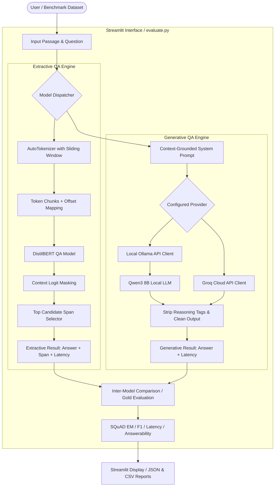

# P31: Extractive vs. Generative Question Answering

A comparative study and modular benchmarking application that analyzes the behavioral differences, latency profiles, answerability handling, and lexical characteristics of **Extractive Question Answering** (using Hugging Face DistilBERT) versus **Generative Question Answering** (using local Ollama/Qwen3 8B or the optional Groq cloud API).

---

## 📌 Project Overview & Problem Statement

Question Answering (QA) systems in Natural Language Processing generally follow two distinct paradigms:
1. **Extractive QA:** Identifies and isolates a contiguous sub-string (span) from the context passage that directly answers the question.
2. **Generative QA:** Reads the passage and synthesizes a natural-language response, rephrasing facts or combining multiple pieces of context.

### The Problem
While Large Language Models (LLMs) are widely assumed to be superior for all QA tasks, they introduce significant latency overhead, computational requirements, and the risk of hallucination or unconstrained generation. Conversely, extractive models are orders of magnitude faster and strictly bounded by the input text, but cannot perform arithmetic reasoning, multi-hop synthesis, or formulate fluent conversational sentences. Furthermore, standard extractive models trained on SQuAD 1.1 struggle when a question is unanswerable from the passage, often extracting an arbitrary span instead of abstaining.

### Project Objective
This project builds an end-to-end framework to:
- Directly compare both QA paradigms on identical inputs through an interactive Streamlit application.
- Evaluate both models against a curated 20-question gold-standard benchmark spanning five distinct query categories.
- Objectively measure inference latency, exact match (EM), token-level F1, answerability accuracy, and failure modes; the default local workflow does not require paid APIs or cloud services.

---

## 🔬 Extractive vs. Generative QA Comparison

| Dimension | Extractive QA (`DistilBERT`) | Generative QA (`Qwen3 8B` via Ollama; Groq cloud optional) |
| :--- | :--- | :--- |
| **Model Architecture** | Transformer Encoder (`DistilBertForQuestionAnswering`) | Autoregressive Decoder-Only LLM (`Qwen3 8B`) |
| **Inference Mechanism** | Predicts start and end token logits over context | Generates token sequences autoregressively |
| **Answer Format** | Verbatim text slice extracted from context | Synthesized natural-language response |
| **Arithmetic / Synthesis** | Cannot perform calculations or combine disjoint facts | Can compute simple differences, sums, and inferences |
| **Handling Unanswerable Queries** | Tends to extract an unsupported span (forced extraction) | Can abstain when instructed (*"The passage does not contain..."*) |
| **Inference Latency** | Ultra-low (~0.10s on CPU) | Moderate (~3.7s–6.3s on local hardware) |
| **Compute Footprint** | Lightweight (~260 MB weights) | Substantial (~5.2 GB Q4_K_M GGUF weights) |

---

## 🚀 Key Features

- **Interactive Streamlit Web Interface:** Side-by-side display of extractive and generative answers, per-model latency, uncalibrated span confidence, and supporting context excerpts.
- **Sliding-Window Chunking for Long Passages:** Extractive inference segments passages exceeding 512 tokens using overlapping strides (`max_seq_length=512`, `doc_stride=128`), resolving token offsets back to exact character positions in the source passage.
- **Inter-Model Disagreement Analysis:** Computes directional token precision, token recall, token F1, and span containment between both model outputs without confusing inter-model divergence with ground-truth accuracy.
- **Gold-Standard 20-Question Benchmark:** A balanced dataset evaluating Direct Factual, Named Entity, Numerical, Simple Inference/Calculation, and Unanswerable queries.
- **Standardized Evaluation Framework (`evaluate.py`):** Implements official SQuAD-style normalization, multi-reference matching, answerability scoring, and false-answer tracking with output to structured JSON and CSV files.
- **Local or Hosted Generative QA:** Ollama remains the default and supports offline-capable local execution; Groq can be configured as an optional hosted provider.

---

## 🛠️ Technology Stack

- **Language:** Python 3.11 (tested; compatible with Python 3.10–3.12)
- **Extractive QA Backend:** [Hugging Face Transformers](https://huggingface.co/docs/transformers) & [PyTorch](https://pytorch.org/) (`distilbert/distilbert-base-cased-distilled-squad`)
- **Generative QA Backend:** Local [Ollama](https://ollama.com/) running `qwen3:8b` by default, or Groq cloud using the [OpenAI Python SDK](https://github.com/openai/openai-python) compatible API
- **Frontend / UI:** [Streamlit](https://streamlit.io/)
- **Metrics & Evaluation:** Custom SQuAD-standard evaluation engine (Exact Match, Token F1, Directional Overlap, Answerability Accuracy)

---

## 🏗️ System Architecture & Workflow



---

## 📁 Project Folder Structure

```
P31-Extractive-Generative-QA/
│
├── app.py                   # Streamlit web application interface
├── config.py                # System constants, model identifiers, and preset scenarios
├── extractive_qa.py         # DistilBERT AutoModel sliding-window inference and span extraction
├── generative_qa.py         # Ollama/Groq client wrapper with strict grounding prompt
├── comparison.py            # Inter-model comparison and directional overlap metrics
│
├── benchmark_dataset.json   # 20 verified passage-question-answer benchmark pairs
├── evaluate.py              # Benchmark evaluation CLI script
├── test_evaluate.py         # Unit tests for evaluation logic and metric aggregations
├── test_suite.py            # Comprehensive test suite for core QA modules
├── test_excerpt.py          # Dedicated verification test for context excerpt slicing
│
├── benchmark_results.json   # Output results of the 20-question benchmark evaluation
├── benchmark_results.csv    # Tabular predictions, latencies, and metrics per question
├── RESULTS.md               # Detailed benchmark evaluation report and analysis
└── README.md                # Project documentation
```

---

## 💻 Installation & Setup (Windows)

### 1. Prerequisites
- **Python:** Python 3.10 to 3.12 (developed and verified on Python 3.11).
- **Ollama:** Download and install Ollama from [ollama.com](https://ollama.com/).
- **Git:** Installed on Windows.

### 2. Clone and Navigate to the Repository
```powershell
git clone <repository-url>
cd P31-Extractive-Generative-QA
```

### 3. Create & Activate Virtual Environment
```powershell
# Create virtual environment
python -m venv venv

# Activate on Windows PowerShell
.\venv\Scripts\Activate.ps1
# (If execution is restricted, run: Set-ExecutionPolicy -Scope Process -ExecutionPolicy Bypass)

# Install runtime dependencies
pip install -r requirements.txt
```

### 4. Configure Local Ollama
In a separate terminal or background session, ensure the Ollama service is active and pull the `qwen3:8b` model:
```bash
# Start Ollama service (if not already running as a Windows service)
ollama serve

# Download the Qwen3 8B model
ollama pull qwen3:8b
```
Verify the model is ready:
```bash
ollama list
```
The endpoint is available by default at `http://localhost:11434/v1`.

### Cloud Deployment (Groq)

Ollama remains the default when `QA_PROVIDER` is unset. To use Groq for local testing, add the following settings to `.streamlit/secrets.toml` and replace the API key value with your key:

```toml
QA_PROVIDER = "groq"
GROQ_API_KEY = "..."
GROQ_MODEL = "openai/gpt-oss-20b"
```

For hosted deployment (for example, Streamlit Community Cloud), add the same settings to the hosting platform's Secrets manager rather than committing credentials to the repository.

---

## 🖥️ Running the Streamlit Application

Launch the web application with Streamlit:
```powershell
.\venv\Scripts\streamlit.exe run app.py
```
Open your web browser and navigate to:
```
http://localhost:8501
```

### How to Use the UI:
1. **Sidebar Configuration:** Inspect the active provider's connection status (Ollama by default, or Groq when configured). Adjust temperature, max output tokens, or max extractive span length if desired.
2. **Preset Scenarios:** Select a preloaded test case from the **Load Sample Passage & Question** dropdown (e.g., *Apollo 11*, *James Webb Space Telescope*, *Photosynthesis*, or *Unanswerable Query*).
3. **Custom Queries:** Paste custom text into the **Context Passage** text area and enter a question.
4. **Compare Models:** Click **🔍 Compare QA Models** to execute side-by-side inference.
5. **Review Outputs:** Inspect the answers, latency metrics, uncalibrated span confidence, supporting context excerpts, and the inter-model lexical overlap breakdown.

---

## 📊 Running Automated Tests & Benchmark Evaluation

### 1. Run Core System Test Suite
Executes extractive and comparison tests, Ollama integration checks when Ollama is reachable, and mocked Groq provider checks without requiring a Groq API key:
```powershell
.\venv\Scripts\python.exe test_suite.py
```

### 2. Run Evaluation Logic Unit Tests
Verifies SQuAD Exact Match, multi-reference selection, unanswerable abstention scoring, and aggregation calculations:
```powershell
.\venv\Scripts\python.exe test_evaluate.py
```

### 3. Run the Full 20-Question Benchmark
Runs both DistilBERT and Qwen3 8B across all 20 gold-standard questions, logging console metrics and generating structured JSON and CSV reports:
```powershell
.\venv\Scripts\python.exe evaluate.py --dataset benchmark_dataset.json --output-json benchmark_results.json --output-csv benchmark_results.csv
```

### 4. Run Benchmark Subsets (Validation / Category Filters)
```powershell
# Quick validation test on first 2 items
.\venv\Scripts\python.exe evaluate.py --limit 2

# Filter by question category
.\venv\Scripts\python.exe evaluate.py --category direct_factual
.\venv\Scripts\python.exe evaluate.py --category unanswerable
.\venv\Scripts\python.exe evaluate.py --category inference_calculation
```

---

## 📸 Application Screenshots

> *Note: Place your UI screen captures into a `screenshots/` directory and update the relative links below.*

| Main Comparison Interface | Disagreement & Lexical Analysis |
| :---: | :---: |
| `` | `` |
| *Side-by-side answers, latencies, and metrics* | *Directional token overlap and divergence analysis* |

---

## ⚠️ Current Limitations & Future Enhancements

### Current Limitations:
1. **Extractive Abstention:** DistilBERT is fine-tuned on standard SQuAD 1.1 without a calibrated null-answer classifier. On unanswerable questions, it forces a span selection rather than abstaining.
2. **Generative Sentence Structure vs. EM:** Qwen3 8B frequently outputs complete, grammatically fluent sentences (e.g. *"The human heart contains four chambers."*). While factually accurate, this reduces strict string Exact Match against concise reference spans (`"four"`), even though token F1 remains high.
3. **Small Benchmark Scale:** The curated benchmark consists of exactly 20 manually verified questions. While balanced across five categories, it serves as an illustrative demonstration rather than an exhaustive statistical evaluation.
4. **Local Hardware Latency:** Local LLM inference on CPU / consumer GPU takes ~3.7s–6.3s per query, compared to ~0.10s for the extractive encoder.

### Future Enhancements:
- **Calibrated Null-Score Thresholding:** Implement SQuAD 2.0 style `[CLS]` token thresholding for DistilBERT to enable genuine extractive abstention.
- **Semantic Embedding Similarity:** Supplement token-level SQuAD metrics with sentence embedding cosine similarity (e.g. `all-MiniLM-L6-v2`) to award full credit for valid paraphrases.
- **RAG Extension:** Integrate document retrieval (BM25 or dense vector search) to fetch relevant passages dynamically from a larger corpus before question answering.
- **Streaming Generative Responses:** Stream generative tokens directly to the Streamlit UI to improve perceived latency.
